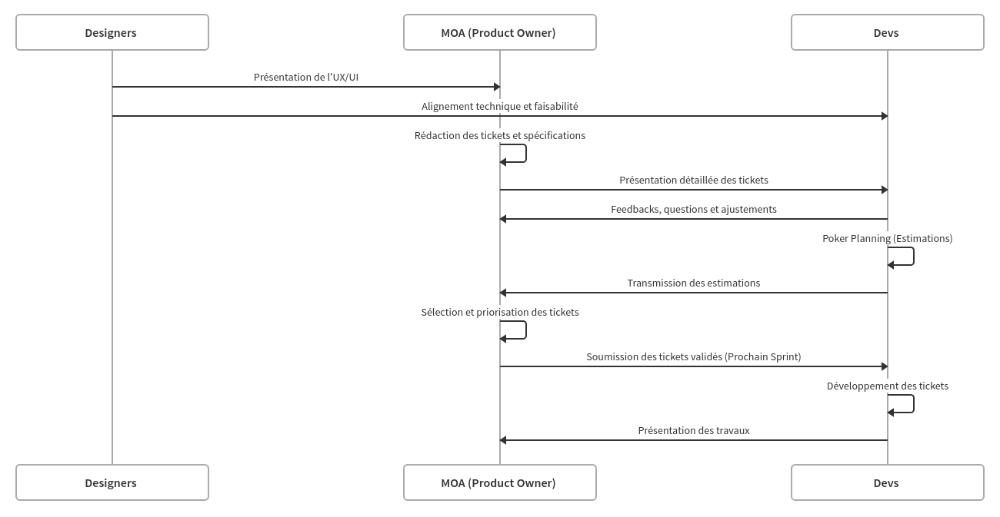
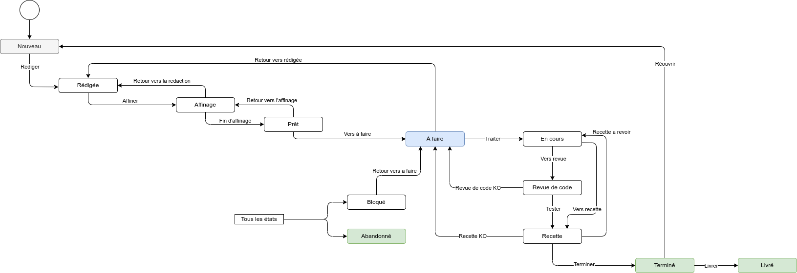
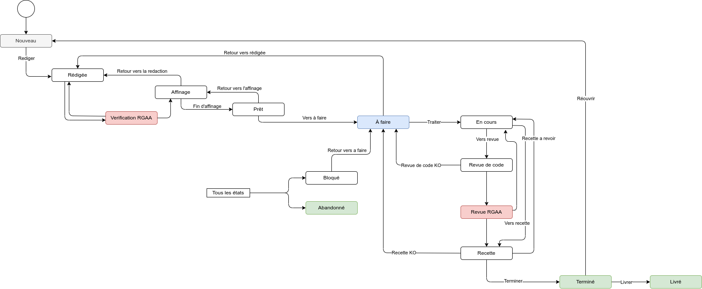
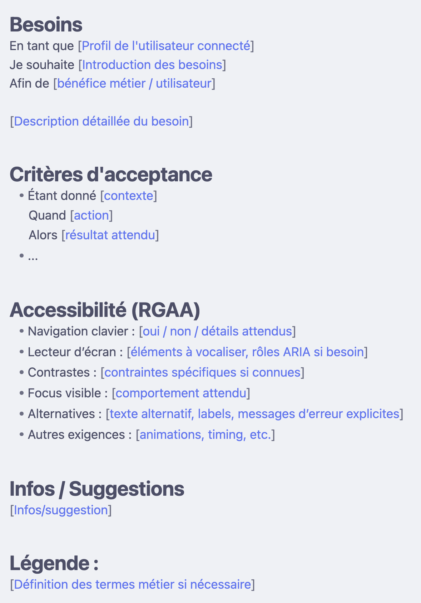
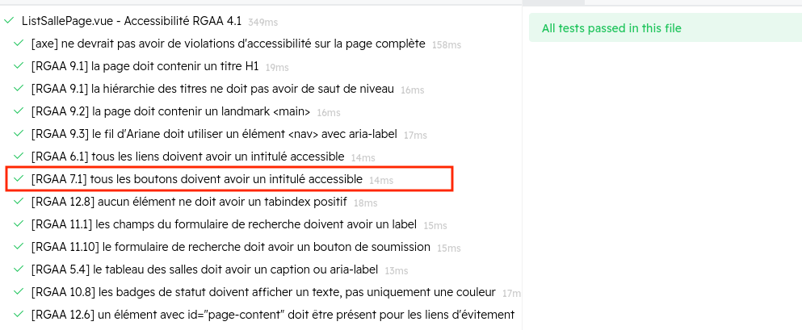

# CASE STUDY: From RGAA compliance to industrialization
<tags>
    <tag label="Digital Accessibility"></tag>
    <tag label="RGAA v4.1"></tag>
    <tag label="Digital Inclusion"></tag>
    <tag label="Agile Methodology"></tag>
    <tag label="Shift-Left"></tag>
    <tag label="Change Management"></tag>
    <tag label="Automated Testing"></tag>
    <tag label="CI/CD"></tag>
</tags>

*Software engineering case study* \
**How to reduce the technical debt of a large-scale national business application and sustainably transform a product team's practices without slowing its velocity.**

---

### Executive summary

During the redesign of a critical training management application intended for more than $9\ 000$ users (including $5\ 000$ learners), the first version (V1) was delivered to production without systematic integration of accessibility standards (RGAA). As the national deployment of version 2 (V2) approached, subject to a legal compliance requirement above $80\%$, the team faced a dual challenge: correct existing technical debt while preventing the emergence of new defects. By deploying a *Shift-Left* strategy (role-specific checklists, Agile workflow evolution, automated `axe-core` unit tests, and semantic refactoring), the project began its transition from a late-correction logic to natively accessible design.

---

## 1. Context and genesis of the project

Within the software development unit of a large public administration, my team designs and maintains critical information systems. As part of a comprehensive technology modernization (migration of legacy PHP applications to a modern Java / Vue.js architecture on Cloud infrastructure), I contributed to the development of a central web platform dedicated to tracking training and schooling pathways for staff.

This application replaces several heterogeneous local tools. It addresses a wide range of users: department managers, trainers, institution administrators, and more than $5\ 000$ trainees in initial training. While version 1 (V1) was already in use on a restricted internal scope, the preparation of version 2 (V2) planned its opening to all internal and external candidates at the national level.

### 1.1 Technical and human environment

>
>
> **Figure 1:** Overview of the actors and the team's initial agile workflow


The project relies on a multidisciplinary organization operating according to Agile and DevOps principles (3-week sprints):

* **Project Ownership (MOA):** composed of a department manager, a Product Owner, and a representative of end users, it writes business needs in the form of *User Stories*.
* **The Design unit (UX/UI):** a team of three designers designs graphical mockups and interactive prototypes on Figma based on the official Government design system.
* **Project Management (MOE):** a development team (experienced developers, apprentices, Technical Lead, Scrum Master) supported by a cross-functional Cloud operations (Ops) team.
* **Technology stack:** Java backend (secure internal framework based on Spring Boot) and PostgreSQL database; Frontend developed with an internal framework based on Vue.js and TypeScript, encapsulating the official DSFR component library (Government Design System).

---

>
>
> **Figure 2:** Initial Jira workflow (ticket lifecycle before integration of RGAA controls)

---

### 1.2 Digital accessibility as a legal and ethical requirement

Digital accessibility consists in designing web interfaces usable by everyone, including people with disabilities (visual, motor, auditory, or cognitive) or facing temporary disability (injury, visual fatigue, mobile navigation). In France, Article 47 of the law of February 11, 2005 requires public digital services to comply with the RGAA (General Reference Framework for Accessibility Improvement), broken down into 106 technical criteria derived from international WCAG standards.

Beyond the legal obligation and the ethical requirement of equal access to public services, accessibility directly improves general ergonomics, code readability, and software maintainability for all users.

---

## 2. Problem statement and diagnosis of the existing system

During the rapid development of V1, accessibility had not been integrated as a structuring sprint requirement. Normative checks were relegated to the very end of the cycle, just before production release, in the form of an external audit requiring a minimum compliance score of $80\%$ to authorize the national deployment of V2.

> **Central problem statement:** How can a digital accessibility (RGAA) approach be integrated and industrialized within a pre-existing Agile development cycle in order to reduce accumulated technical debt, while guaranteeing native compliance of future developments without slowing the team's velocity?

### 2.1 Risk mapping and flow analysis

The analysis of existing work processes (from the Figma mockup to the JIRA ticket through to code review) revealed a siloed operation in which accessibility remained invisible until final acceptance testing. This organization exposed the project to four major risks:

| Nature of risk | Observation on the initial flow | Potential impact on the product and the team |
| :--- | :--- | :--- |
| **Legal and reputational risk** | Expansion of V2 to external candidates without prior upgrading of interfaces. | Legal non-compliance (2005 law), exclusion of future staff with disabilities, and risk of legal challenge. |
| **Scheduling risk** | Detection of defects concentrated during the final audit before production release. | Bottleneck effect forcing either postponement of the national delivery or delivery of a non-compliant version. |
| **Financial risk (Boehm's law)** | Lack of control from the design and specification-writing phase. | The cost of fixing a defect (e.g., contrast or structure) grows exponentially when it is discovered after coding. |
| **Technical risk (Debt)** | Lack of technical guidelines and automated tests in the CI/CD chain. | Fixes made under pressure ("patches"), code weakening, frequent regressions, and component heterogeneity. |

### 2.2 Manual audit of V1: technical debt mapping

In order to precisely target priority workstreams without wasting time on statistical counting that is of little use to developers, I conducted a qualitative manual audit on a representative sample of V1 screens (multi-criteria search, detailed trainee record, creation forms, and modals). This evaluation combined DOM inspection, keyboard-only navigation, $200\%$ zoom tests, color blindness simulation, and use of the Orca screen reader.

| RGAA topic | V1 status | Identified technical finding | Concrete impact for the user |
| :--- | :--- | :--- | :--- |
| **Colors and contrasts** | Compliant | Government Design System (DSFR) palette respecting contrast ratios and resistant to simulations (deuteranopia, achromatopsia). | Good overall readability of texts and status badges, with information duplicated by a textual label. |
| **Presentation and 200% zoom** | Non-compliant | Custom CSS conflicts causing action buttons to be reversed and data columns to overlap at $200\%$ zoom. | Disorientation of visually impaired users and risk of manipulation error (clicking "Reset" instead of "Search"). |
| **HTML structure and semantics** | Partial | Use of generic `<div>` tags instead of `<main>`; jumps in heading hierarchy (moving from `<h2>` to `<h4>`) and presence of two `<h1>` elements. | Inability for a screen reader to access the main content directly or to understand the logical page outline. |
| **Keyboard navigation** | Non-compliant | Inconsistent tab order on search filters (focus skips the "First name" field) and sometimes poorly visible focus indicator. | Break in predictability and significant muscle fatigue for people navigating without a mouse (motor disability). |
| **Forms and components** | Non-compliant | Input fields without associated `<label>` tags, `<select>` drop-down lists blocked with the keyboard, and generic action buttons in tables. | Forms incomprehensible or inoperable via speech synthesis; inability to identify the row concerned by an action button. |


## 3. Design of the system: the "Shift-Left" approach

To move away from the logic of late correction, I structured a methodology inspired by the DevOps "*Shift-Left*" paradigm (shifting left). The principle is simple: move quality and accessibility controls as far upstream as possible in a feature's lifecycle (starting from the graphic mockup and the writing of the business ticket), in order to prevent defects even before they are coded.

### 3.1 Three operational checklists integrated into Agile rituals

Rather than imposing the reading of the 106 raw RGAA criteria on the whole team, I translated the normative requirements into three short verification grids, targeted by role and activated at key moments in the sprint:

* **Checklist 1, design phase (UX/UI):** used during the presentation of Figma mockups to validate non-text contrasts ($3:1$), the appearance of the keyboard focus indicator, the distinction between decorative and informative icons, the visual logic of headings, and behavior at $200\%$ zoom.
* **Checklist 2, refinement phase (MOA / Product Owner):** applied when writing *User Stories* to define upstream the semantic and editorial elements: unique browser tab title, explicit link labels, educational error messages (indicating the nature of the error and an example format), and dynamic voice announcements (ARIA live regions).
* **Checklist 3, development phase (code & code review):** integrated into the *Definition of Done* (DoD) as a technical safety net before validation: presence of structuring regions (`<header>`, `<main>`, `<nav>`, `<footer>`), compliance with heading hierarchy, strict `<label>` / `<input>` association, focus trapping in modal windows, and full keyboard navigation.

### 3.2 Evolution of the ticket lifecycle and change management

In collaboration with the Scrum Master, I designed a new JIRA ticket template integrating a section dedicated to accessibility (keyboard navigation, screen reader vocalization, focus management, text alternatives) as well as two control milestones in the workflow: an **RGAA Check** before refinement and an **RGAA Review** after code review.

Faced with the constraints inherent in any organizational transformation (administrative delays in modifying the official Kanban board and the MOA's fear of seeing *story point* estimates increase), I adopted a pragmatic bootstrapping strategy. By temporarily assuming the role of accessibility referent in tandem with a female developer, we analyzed tickets 48 hours before each refinement meeting in order to concretely demonstrate to the team that anticipating RGAA criteria makes estimates more reliable and avoids returns during acceptance testing.


---

>
>
> **Figure 3:** Redesign of the Jira workflow (ticket lifecycle after integration of RGAA controls)
>

> 
>
> **Figure 3:** New Jira template with integration of RGAA controls

---

### 3.3 Knowledge capitalization and technical documentation

To make the team autonomous and perpetuate good practices on the internal collaborative space (Confluence), I wrote two reference materials directly action-oriented:

* **A structured technical glossary:** organized by functional family (semantic tags, forms, tables, WAI-ARIA attributes and roles), offering quick access to good practices without requiring searches in the legal reference framework.
* **A complete guide to RGAA unit tests:** including naming conventions, technical configuration, ready-to-copy-paste code templates, and the translation of about fifteen RGAA criteria into automated assertions.

---

## 4. Technical implementation, refactoring, and automation

Technically, compliance presented a strong architectural constraint: the application relies on an internal framework encapsulating the DSFR graphical components whose internal source code cannot be directly modified. I therefore deployed a dual strategy: pool fixes at the source on the project's custom components (such as back buttons or page containers) and systematically enrich the framework components when they are instantiated via standard HTML and ARIA attributes.

### 4.1 Concrete examples of technical remediation

Three representative interventions illustrate how normative compliance was reconciled with strict adherence to the graphic mockups:

* **Decouple HTML semantics from visual rendering of headings:** on several pages, section headings used `<h3>` or `<h4>` tags only to obtain a smaller font size, creating hierarchical breaks. By using DSFR utility classes (e.g., `<h2 class="fr-h3">`), I restored a continuous logical tree ($h1 \rightarrow h2 \rightarrow h3$) while maintaining a visual rendering strictly identical to the mockups.
* **Contextualize actions in data tables:** in the tables listing training courses, each row had three icon buttons ("View", "Edit", "Delete"). With speech synthesis, a user navigating from button to button heard these verbs repeated without knowing which row they applied to. I kept the short visual label while dynamically injecting an explicit `aria-label` attribute (e.g., "Edit the training Inspecteur des Finances Publiques").
* **Structure page regions and forms:** I wrapped the main views in a semantic `<main>` tag divided into functional `<section>` elements (allowing screen readers to use quick-access shortcuts), associated each form field with a real `<label>` tag, and restored native keyboard submission via `<form>`.

```html
<!-- Example of dynamic contextualization of an action button in a Vue.js / DSFR table -->
<fr-button
  iconName="edit-line"
  label="Edit"
  :aria-label="`Edit training ${data.formation}`"
  @click="goToModifScolarite(data)"
/>
```

### 4.2 Automation of accessibility tests in the CI/CD pipeline

To prevent any regression during future sprints, I set up a suite of unit tests dedicated to accessibility, automatically executed in the continuous integration pipeline (GitLab CI / Jenkins). To respect the single responsibility principle and facilitate diagnosis in case of failure, these tests are isolated from classic functional tests via a dedicated naming convention: `[ComponentName].a11y.spec.ts`.

Each test file combines two levels of verification:

1. **A global automated audit via `axe-core`:** executed on the different states of a component (empty form, pre-filled in edit mode, and with validation error messages displayed) to instantly detect WCAG/RGAA syntax violations.
2. **Targeted unit assertions `[RGAA X.Y]`:** verifying precise structural rules specific to the French reference framework (presence of a single `<h1>`, absence of heading level jumps, presence of the `<main>` landmark, systematic association of form labels, or absence of a positive `tabindex` attribute).

```typescript
// Extract from an accessibility unit test file (FormSalle.a11y.spec.ts)
it('[axe] should not have accessibility violations in add mode', async () => {
  const { container } = renderFormSalle();
  const results = await axe(container, axeConfig);
  expect(results).toHaveNoViolations();
});

it('[RGAA 11.1] all input fields must have an associated label', async () => {
  const { container } = renderFormSalle();
  const inputs = container.querySelectorAll('input, select, textarea');
  inputs.forEach((input) => {
    const id = input.getAttribute('id');
    const hasLabel = container.querySelector(`label[for="${id}"]`) !== null
      || input.hasAttribute('aria-label') 
      || input.hasAttribute('aria-labelledby');
    expect(hasLabel).toBe(true);
  });
});
```

### 4.3 Limits of automation and hybrid approach

A major lesson from this approach is that automated tests technically cover only $30$ to $40\%$ of RGAA criteria. A test passing green guarantees the absence of structural errors (e.g., a button does have a label), but cannot judge the human relevance of that label or the actual fluidity of a keyboard journey. Automation thus acts as an indispensable preventive filter, but must imperatively be completed by manual verifications (dedicated browser extensions and screen reader) to avoid any "false sense of security".

> 
>
> **Figure 4:** Result of executing accessibility unit tests: illustration of the limits of automation. Although the scripts validate technical syntax (tests passing green), manual verification remains indispensable to judge semantic relevance (e.g., the RGAA 7.1 label)
---

## 5. Assessment, lessons learned, and perspectives

The progressive deployment of this system on version 2 of the application produced tangible results both technically and in the team's collective dynamics.

| Evaluation area | Observed results | Lessons learned and points of attention |
| :--- | :--- | :--- |
| **Development practices** | Rapid adoption of the unit test guide (ready-to-use templates) and systematic use of the development checklist during code review. | Developers favor operational tools that save them time and secure their deliveries against regressions. |
| **UX/UI design** | Native integration of RGAA requirements from the creation of new graphic mockups by the design team. | *Shift-Left* occurred naturally on the design side, reducing back-and-forth during integration. |
| **Change management (MOA)** | Proven effectiveness of the refinement checklist in removing functional ambiguities before sprints begin. | Human support and demonstration by example remain essential to remove obstacles related to the estimated workload of tickets. |
| **V2 code quality** | Reduction of the main semantic, keyboard, and form debts on audited screens and new modules. | The combination of automated tests (CI/CD) + targeted manual acceptance testing calmly prepares for the official external compliance audit. |

### 5.1 Personal assessment and engineering posture

This end-of-studies mission allowed me to make a significant transition: from purely technical expertise (backend development and performance optimization during my first two apprenticeship years) to a cross-functional software engineer posture combining frontend architecture, industrial quality, and change management.

The main lesson of this project is that the technical dimension is often simpler to master than human and organizational support. Establishing an accessibility culture requires pedagogy, empathy toward end users, and pragmatism to equip teams without weighing down their daily work.

### 5.2 Prospects for evolution

In the short term, the priority is to finalize automated test coverage across all critical screens in order to calmly validate the external compliance audit prior to the national deployment of V2. In the medium term, the objective is to complete the transfer of skills to Project Ownership so that writing accessibility criteria becomes a fully autonomous reflex in each *User Story*, while exploring the potential contribution of semantic analysis tools hosted on sovereign internal infrastructures.

---
<cards>
<card title="V1 workstream: reduction of technical debt (corrective component)">

**Initial state**

Accessibility was taken into account occasionally at the end of the cycle, only through the native contrasts of the design system (DSFR).

**My intervention**

I manually audited the existing system, refactored the semantics of shared components (`<main>` landmarks, heading hierarchy, labels, keyboard navigation), and set up axe-core unit tests.

**Result**

100% of structural non-conformities identified during the internal audit were corrected. The base is sound for scaling up.

</card>
<card title="V2 workstream: "Shift-Left" industrialization (preventive component)">

**Initial state**

Risk of a funnel effect and correction cost overruns before the external national audit (required threshold > 80%).

**My intervention**

I deployed 3 business checklists (design, MOA refinement, development), adapted the JIRA ticket template, and wrote a ready-to-use unit test guide on Confluence.

**Result**

Accessibility is natively integrated at each sprint stage (mockups, specifications, code review, and CI/CD) and sustainably limits the emergence of new technical debt.

</card>
</cards>