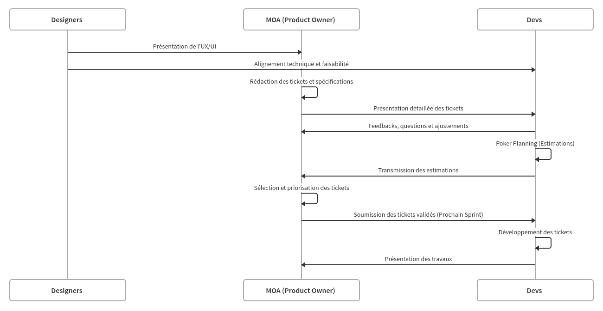
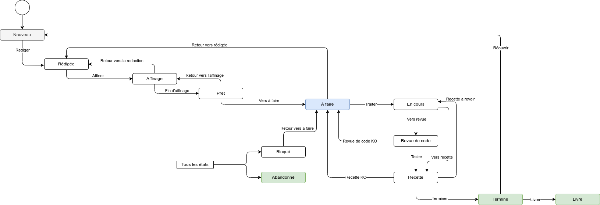
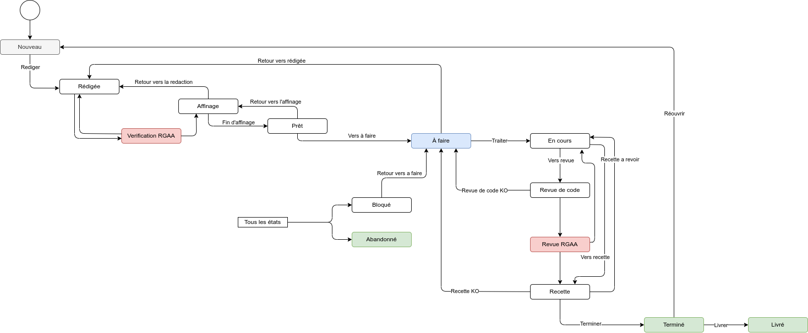
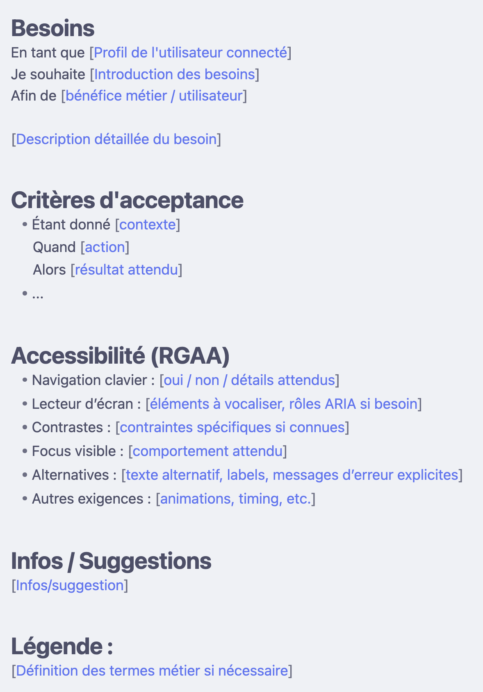
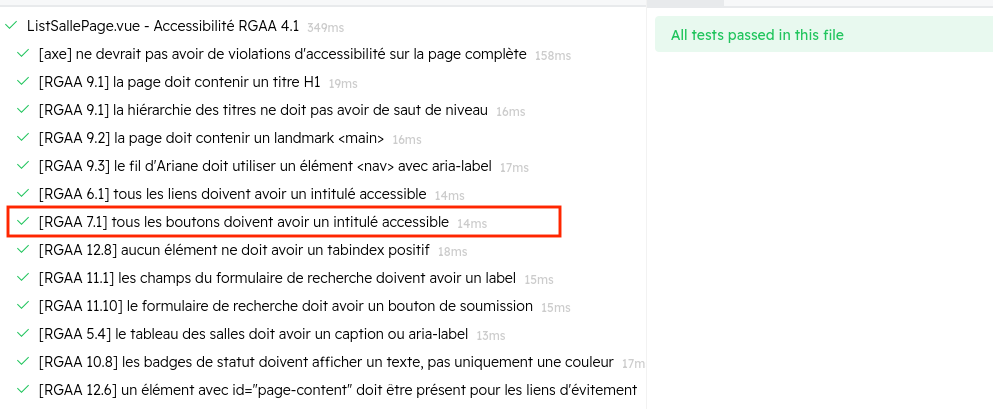

# ÉTUDE DE CAS : De la mise en conformité RGAA à l'industrialisation
<tags>
    <tag label="Accessibilité Numérique"></tag>
    <tag label="RGAA v4.1"></tag>
    <tag label="Inclusion Numérique"></tag>
    <tag label="Méthodologie Agile"></tag>
    <tag label="Shift-Left"></tag>
    <tag label="Conduite du Changement"></tag>
    <tag label="Tests Automatisés"></tag>
    <tag label="CI/CD"></tag>
</tags>

*Étude de cas d'ingénierie logicielle* \
**Comment résorber la dette technique d'une application métier d'envergure nationale et transformer durablement les pratiques d'une équipe produit sans ralentir sa vélocité.**

---

### Résumé exécutif

Lors de la refonte d'une application critique de gestion des formations destinée à plus de $9\ 000$ utilisateurs (dont $5\ 000$ apprenants), la première version (V1) a été livrée en production sans intégration systématique des normes d'accessibilité (RGAA). À l'approche du déploiement national de la version 2 (V2), soumise à une exigence légale de conformité supérieure à $80\%$, l'équipe faisait face à un double défi : corriger la dette technique existante tout en empêchant l'apparition de nouvelles anomalies. En déployant une stratégie *Shift-Left* (checklists par métier, évolution du workflow Agile, tests unitaires automatisés `axe-core` et refactoring sémantique), le projet a amorcé sa transition d'une logique de correction tardive vers une conception nativement accessible.

---

## 1. Contexte et genèse du projet

Au sein d'un pôle de développement informatique d'une grande administration publique, mon équipe assure la conception et la maintenance de systèmes d'information critiques. À l'occasion d'une modernisation technologique globale (migration d'applications historiques PHP vers une architecture moderne Java / Vue.js sur infrastructure Cloud), j'ai contribué au développement d'une plateforme web centrale dédiée au suivi des parcours de formation et de scolarité des agents.

Cette application remplace plusieurs outils locaux hétérogènes. Elle s'adresse à un large panel d'utilisateurs : responsables de service, formateurs, administrateurs d'établissements et plus de $5\ 000$ stagiaires en formation initiale. Alors que la version 1 (V1) était déjà exploitée sur un périmètre interne restreint, la préparation de la version 2 (V2) prévoyait son ouverture à l'ensemble des candidats internes et externes à l'échelle nationale.

### 1.1 L'environnement technique et humain

>
>
> **Figure 1 :** Vue d'ensemble des acteurs et du workflow agile initial de l'équipe


Le projet repose sur une organisation pluridisciplinaire fonctionnant selon les principes Agile et DevOps (sprints de 3 semaines) :

* **La Maîtrise d'Ouvrage (MOA) :** composée d'une responsable de service, d'une Product Owner et d'une représentante des utilisateurs finaux, elle rédige les besoins métiers sous forme de *User Stories*.
* **Le pôle Design (UX/UI) :** une équipe de trois designers conçoit les maquettes graphiques et prototypes interactifs sur Figma en s'appuyant sur le système de design officiel de l'État.
* **La Maîtrise d'Œuvre (MOE) :** une équipe de développement (développeurs confirmés, alternants, Leader Technique, Scrum Master) appuyée par une équipe transverse d'exploitation Cloud (Ops).
* **La stack technologique :** Backend en Java (framework interne sécurisé basé sur Spring Boot) et base de données PostgreSQL ; Frontend développé avec un framework interne basé sur Vue.js et TypeScript, encapsulant la bibliothèque de composants officielle DSFR (Système de Design de l'État).

---

>
>
> **Figure 2 :** Workflow Jira initial (cycle de vie d’un ticket avant l'intégration des contrôles RGAA)

---

### 1.2 L'accessibilité numérique comme exigence légale et éthique

L'accessibilité numérique consiste à concevoir des interfaces web utilisables par tous, y compris par les personnes en situation de handicap (visuel, moteur, auditif ou cognitif) ou confrontées à un handicap temporaire (blessure, fatigue visuelle, navigation sur mobile). En France, l'article 47 de la loi du 11 février 2005 impose aux services numériques publics de respecter le RGAA (Référentiel Général d'Amélioration de l'Accessibilité), décliné en 106 critères techniques issus des normes internationales WCAG.

Au-delà de l'obligation légale et de l'exigence éthique d'égalité d'accès au service public, l'accessibilité améliore directement l'ergonomie générale, la lisibilité du code et la maintenabilité logicielle pour l'ensemble des utilisateurs.

---

## 2. Problématique et diagnostic de l'existant

Lors du développement rapide de la V1, l'accessibilité n'avait pas été intégrée comme une exigence structurante des sprints. Les vérifications normatives étaient reléguées en toute fin de cycle, juste avant la mise en production, sous forme d'un audit externe exigeant un score minimal de $80\%$ de conformité pour autoriser le déploiement national de la V2.

> **Problématique centrale :** Comment intégrer et industrialiser une démarche d'accessibilité numérique (RGAA) au sein d'un cycle de développement Agile préexistant afin de résorber la dette technique accumulée, tout en garantissant la conformité native des futures évolutions sans freiner la vélocité de l'équipe ?

### 2.1 Cartographie des risques et analyse des flux

L'analyse des processus de travail existants (de la maquette Figma au ticket JIRA jusqu'à la revue de code) a mis en évidence un fonctionnement en silo où l'accessibilité restait invisible jusqu'à la recette finale. Cette organisation exposait le projet à quatre risques majeurs :

| Nature du risque | Constat sur le flux initial | Impact potentiel sur le produit et l'équipe |
| :--- | :--- | :--- |
| **Risque juridique et d'image** | Élargissement de la V2 aux candidats externes sans mise à niveau préalable des interfaces. | Non-conformité légale (loi de 2005), exclusion de futurs agents en situation de handicap et risque de recours. |
| **Risque de planning** | Détection des anomalies concentrée lors de l'audit final avant la mise en production. | Effet goulot d'étranglement obligeant soit à reporter la livraison nationale, soit à livrer une version non conforme. |
| **Risque financier (Loi de Boehm)** | Absence de contrôle dès la phase de design et de rédaction des spécifications. | Le coût de correction d'une anomalie (ex. : contraste ou structure) croît exponentiellement lorsqu'elle est découverte après le codage. |
| **Risque technique (Dette)** | Absence de directives techniques et de tests automatisés dans la chaîne CI/CD. | Corrections réalisées sous pression (« patchs »), fragilisation du code, régressions fréquentes et hétérogénéité des composants. |

### 2.2 Audit manuel de la V1 : cartographie de la dette technique

Afin de cibler précisément les chantiers prioritaires sans perdre de temps dans un comptage statistique peu exploitable pour les développeurs, j'ai mené un audit manuel qualitatif sur un échantillon représentatif des écrans de la V1 (recherche multicritères, fiche détaillée d'un stagiaire, formulaires de création et modales). Cette évaluation a combiné l'inspection du DOM, la navigation exclusivement au clavier, les tests de zoom à $200\%$, la simulation de daltonisme et l'utilisation du lecteur d'écran Orca.

| Thématique RGAA | État V1 | Constat technique identifié | Impact concret pour l'utilisateur |
| :--- | :--- | :--- | :--- |
| **Couleurs et contrastes** | Conforme | Palette du Système de Design (DSFR) respectant les ratios de contraste et résistant aux simulations (deutéranopie, achromatopsie). | Bonne lisibilité globale des textes et des badges de statut, l'information étant doublée par un libellé textuel. |
| **Présentation et Zoom 200%** | Non conforme | Conflits CSS personnalisés provoquant l'inversion de boutons d'action et le chevauchement de colonnes de données lors d'un zoom à $200\%$. | Désorientation des utilisateurs malvoyants et risque d'erreur de manipulation (clic sur « Réinitialiser » au lieu de « Rechercher »). |
| **Structure et sémantique HTML** | Partiel | Utilisation de balises génériques `<div>` au lieu de `<main>` ; sauts dans la hiérarchie des titres (passage de `<h2>` à `<h4>`) et présence de deux `<h1>`. | Impossibilité pour un lecteur d'écran d'accéder directement au contenu principal ou de comprendre le plan logique de la page. |
| **Navigation au clavier** | Non conforme | Ordre de tabulation incohérent sur les filtres de recherche (le focus saute le champ « Prénom ») et indicateur de focus parfois peu visible. | Rupture de prévisibilité et fatigue musculaire importante pour les personnes naviguant sans souris (handicap moteur). |
| **Formulaires et composants** | Non conforme | Champs de saisie dépourvus d'étiquettes `<label>` liées, listes déroulantes `<select>` bloquées au clavier et boutons d'actions génériques dans les tableaux. | Formulaires incompréhensibles ou inopérables via synthèse vocale ; incapacité d'identifier la ligne concernée par un bouton d'action. |


## 3. Conception du dispositif : l'approche « Shift-Left »

Pour sortir de la logique de correction tardive, j'ai structuré une méthodologie inspirée du paradigme DevOps « *Shift-Left* » (décalage vers la gauche). Le principe est simple : déplacer les contrôles qualité et d'accessibilité le plus en amont possible du cycle de vie d'une fonctionnalité (dès la maquette graphique et la rédaction du ticket métier), afin de prévenir les défauts avant même qu'ils ne soient codés.

### 3.1 Trois checklists opérationnelles intégrées aux rituels Agiles

Plutôt que d'imposer la lecture des 106 critères bruts du RGAA à toute l'équipe, j'ai traduit les exigences normatives en trois grilles de vérification courtes, ciblées par rôle et activées aux moments clés du sprint :

* **Checklist 1, phase de design (UX/UI) :** utilisée lors de la présentation des maquettes Figma pour valider les contrastes non textuels ($3:1$), l'apparence de l'indicateur de focus clavier, la distinction entre icônes décoratives et informatives, la logique visuelle des titres et le comportement au zoom $200\%$.
* **Checklist 2, phase d'affinage (MOA / Product Owner) :** appliquée lors de la rédaction des *User Stories* pour définir en amont les éléments sémantiques et éditoriaux : titre unique de l'onglet navigateur, intitulés explicites des liens, messages d'erreur pédagogiques (indiquant la nature de l'erreur et un exemple de format) et annonces vocales dynamiques (régions live ARIA).
* **Checklist 3, phase de développement (code & revue de code) :** intégrée à la *Definition of Done* (DoD) comme filet de sécurité technique avant validation : présence des régions structurantes (`<header>`, `<main>`, `<nav>`, `<footer>`), respect de la hiérarchie des titres, liaison stricte `<label>` / `<input>`, piégeage du focus dans les fenêtres modales et navigation complète au clavier.

### 3.2 Évolution du cycle de vie des tickets et conduite du changement

En collaboration avec le Scrum Master, j'ai conçu un nouveau modèle de ticket JIRA intégrant une rubrique dédiée à l'accessibilité (navigation clavier, vocalisation lecteur d'écran, gestion du focus, alternatives textuelles) ainsi que deux jalons de contrôle dans le workflow : une **Vérification RGAA** avant l'affinage et une **Revue RGAA** après la revue de code.

Face aux contraintes inhérentes à toute transformation organisationnelle (délais administratifs pour modifier le tableau Kanban officiel et crainte de la MOA de voir l'estimation des *story points* augmenter), j'ai adopté une stratégie d'amorçage pragmatique. En assumant temporairement le rôle de référent accessibilité en binôme avec une développeuse, nous avons analysé les tickets 48 heures avant chaque réunion d'affinage afin de démontrer concrètement à l'équipe que l'anticipation des critères RGAA fiabilise les estimations et évite les retours en recette.


---

>
>
> **Figure 3 :** Refonte du workflow Jira (cycle de vie d’un ticket après l'intégration des contrôles RGAA)
>

> 
>
> **Figure 3 :** Nouveau template Jira avec l'intégration des contrôles RGAA

---

### 3.3 Capitalisation et documentation technique

Pour rendre l'équipe autonome et pérenniser les bonnes pratiques sur l'espace collaboratif interne (Confluence), j'ai rédigé deux supports de référence directement orientés vers l'action :

* **Un glossaire technique structuré :** organisé par famille fonctionnelle (balises sémantiques, formulaires, tableaux, attributs et rôles WAI-ARIA), offrant un accès rapide aux bonnes pratiques sans nécessiter de recherches dans le référentiel juridique.
* **Un guide complet de tests unitaires RGAA :** incluant les conventions de nommage, la configuration technique, des gabarits de code prêts à copier-coller et la traduction d'une quinzaine de critères RGAA en assertions automatisées.

---

## 4. Réalisation technique, refactoring et automatisation

Sur le plan technique, la mise en conformité présentait une contrainte architecturale forte : l'application s'appuie sur un framework interne encapsulant les composants graphiques du DSFR dont le code source interne n'est pas directement modifiable. J'ai donc déployé une double stratégie : mutualiser les correctifs à la source sur les composants personnalisés du projet (comme les boutons de retour ou les conteneurs de pages) et enrichir systématiquement les composants du framework lors de leur instanciation via des attributs HTML et ARIA standards.

### 4.1 Exemples concrets de remédiation technique

Trois interventions représentatives illustrent comment la conformité normative a été conciliée avec le respect strict des maquettes graphiques :

* **Dissocier sémantique HTML et rendu visuel des titres :** sur plusieurs pages, des titres de section utilisaient des balises `<h3>` ou `<h4>` uniquement pour obtenir une taille de police plus petite, créant des ruptures hiérarchiques. En exploitant les classes utilitaires du DSFR (ex. : `<h2 class="fr-h3">`), j'ai restauré une arborescence logique continue ($h1 \rightarrow h2 \rightarrow h3$) tout en conservant un rendu visuel strictement identique aux maquettes.
* **Contextualiser les actions dans les tableaux de données :** dans les tableaux listant les formations, chaque ligne comportait trois boutons icônes (« Consulter », « Modifier », « Supprimer »). À la synthèse vocale, un utilisateur naviguant de bouton en bouton entendait ces verbes répétés sans savoir à quelle ligne ils s'appliquaient. J'ai conservé le libellé visuel court tout en injectant dynamiquement un attribut `aria-label` explicite (ex. : « Modifier la formation Inspecteur des Finances Publiques »).
* **Structurer les régions de page et les formulaires :** j'ai encapsulé les vues principales dans une balise sémantique `<main>` découpée en `<section>` fonctionnelles (permettant aux lecteurs d'écran d'utiliser les raccourcis d'accès rapide), associé chaque champ de formulaire à une véritable balise `<label>` et rétabli la soumission native au clavier via `<form>`.

```html
<!-- Exemple de contextualisation dynamique d'un bouton d'action dans un tableau Vue.js / DSFR -->
<fr-button
  iconName="edit-line"
  label="Modifier"
  :aria-label="`Modifier la formation ${data.formation}`"
  @click="goToModifScolarite(data)"
/>
```

### 4.2 Automatisation des tests d'accessibilité dans la chaîne CI/CD

Pour prévenir toute régression lors des futurs sprints, j'ai mis en place une suite de tests unitaires dédiés à l'accessibilité, exécutés automatiquement dans le pipeline d'intégration continue (GitLab CI / Jenkins). Afin de respecter le principe de responsabilité unique et de faciliter le diagnostic en cas d'échec, ces tests sont isolés des tests fonctionnels classiques via une convention de nommage dédiée : `[NomDuComposant].a11y.spec.ts`.

Chaque fichier de test combine deux niveaux de vérification :

1. **Un audit automatique global via `axe-core` :** exécuté sur les différents états d'un composant (formulaire vide, pré-rempli en mode modification, et avec affichage des messages d'erreur de validation) pour détecter instantanément les violations syntaxiques WCAG/RGAA.
2. **Des assertions unitaires ciblées `[RGAA X.Y]` :** vérifiant des règles structurelles précises propres au référentiel français (présence d'un unique `<h1>`, absence de saut de niveau de titre, présence du landmark `<main>`, association systématique des labels de formulaire ou absence d'attribut `tabindex` positif).

```typescript
// Extrait d'un fichier de test unitaire d'accessibilité (FormSalle.a11y.spec.ts)
it('[axe] ne devrait pas avoir de violations d\'accessibilité en mode ajout', async () => {
  const { container } = renderFormSalle();
  const results = await axe(container, axeConfig);
  expect(results).toHaveNoViolations();
});

it('[RGAA 11.1] tous les champs de saisie doivent avoir un label associé', async () => {
  const { container } = renderFormSalle();
  const inputs = container.querySelectorAll('input, select, textarea');
  inputs.forEach((input) => {
    const id = input.getAttribute('id');
    const hasLabel = container.querySelector(`label[for="${id}"]`) !== null
      || input.hasAttribute('aria-label') 
      || input.hasAttribute('aria-labelledby');
    expect(hasLabel).toBe(true);
  });
});
```

### 4.3 Limites de l'automatisation et approche hybride

Un enseignement majeur de cette démarche est que les tests automatisés ne couvrent techniquement que $30$ à $40\%$ des critères du RGAA. Un test passé au vert garantit l'absence d'erreurs structurelles (ex. : un bouton possède bien un intitulé), mais ne peut pas juger de la pertinence humaine de cet intitulé ni de la fluidité réelle d'un parcours au clavier. L'automatisation agit ainsi comme un filtre préventif indispensable, mais doit impérativement être complétée par des vérifications manuelles (extensions navigateur dédiées et lecteur d'écran) pour éviter tout « faux sentiment de sécurité ».

> 
>
> **Figure 4 :** Résultat de l'exécution des tests unitaires d'accessibilité : illustration de la limite de l'automatisation. Bien que les scripts valident la syntaxe technique (tests au vert), une vérification manuelle reste indispensable pour juger de la pertinence sémantique (ex : l'intitulé RGAA 7.1)
---

## 5. Bilan, enseignements et perspectives

Le déploiement progressif de ce dispositif sur la version 2 de l'application a produit des résultats tangibles tant sur le plan technique que sur la dynamique collective de l'équipe.

| Axe d'évaluation | Résultats observés | Enseignements et points d'attention |
| :--- | :--- | :--- |
| **Pratiques de développement** | Adoption rapide du guide de tests unitaires (gabarits prêts à l'emploi) et utilisation systématique de la checklist de développement en revue de code. | Les développeurs privilégient les outils opérationnels qui leur font gagner du temps et sécurisent leurs livraisons contre les régressions. |
| **Conception UX/UI** | Intégration native des exigences RGAA dès la réalisation des nouvelles maquettes graphiques par l'équipe de designers. | Le *Shift-Left* s'est opéré naturellement côté design, réduisant les allers-retours lors de l'intégration. |
| **Conduite du changement (MOA)** | Efficacité prouvée de la checklist d'affinage pour lever les ambiguïtés fonctionnelles avant le démarrage des sprints. | L'accompagnement humain et la démonstration par l'exemple restent essentiels pour lever les freins liés à la charge estimée des tickets. |
| **Qualité du code V2** | Résorption des principales dettes sémantiques, clavier et formulaires sur les écrans audités et les nouveaux modules. | La combinaison tests automatisés (CI/CD) + recette manuelle ciblée prépare sereinement l'audit externe officiel de conformité. |

### 5.1 Bilan personnel et posture d'ingénieur

Cette mission de fin d'études m'a permis d'opérer une transition marquante : passer d'une expertise purement technique (développement et optimisation de performances backend lors de mes deux premières années d'alternance) à une posture transverse d'ingénieur logiciel alliant architecture frontend, qualité industrielle et conduite du changement.

L'enseignement principal de ce projet est que la dimension technique est souvent plus simple à maîtriser que l'accompagnement humain et organisationnel. Instaurer une culture de l'accessibilité demande de la pédagogie, de l'empathie envers les utilisateurs finaux et du pragmatisme pour outiller les équipes sans alourdir leur quotidien.

### 5.2 Perspectives d'évolution

À court terme, la priorité consiste à finaliser la couverture de tests automatisés sur l'ensemble des écrans critiques afin de valider sereinement l'audit externe de conformité préalable au déploiement national de la V2. À moyen terme, l'objectif est d'achever le transfert de compétences vers la Maîtrise d'Ouvrage afin que la rédaction des critères d'accessibilité devienne un réflexe totalement autonome dans chaque *User Story*, tout en explorant l'apport potentiel d'outils d'analyse sémantique hébergés sur des infrastructures souveraines internes.

---
<cards>
<card title="Chantier V1 : résorption de la dette technique (volet correctif)">

**État initial**

L'accessibilité était prise en compte ponctuellement en fin de cycle, uniquement via les contrastes natifs du système de design (DSFR).

**Mon intervention**

J'ai audité manuellement l'existant, refactoré la sémantique des composants mutualisés (landmarks `<main>`, hiérarchie des titres, labels, navigation clavier) et mis en place des tests unitaires axe-core.

**Résultat**

100 % des non-conformités structurelles identifiées lors de l'audit interne ont été corrigées. La base est saine pour le passage à l'échelle.

</card>
<card title="Chantier V2 : industrialisation « Shift-Left » (volet préventif)">

**État initial**

Risque d'effet entonnoir et de surcoûts de correction avant l'audit national externe (seuil requis > 80 %).

**Mon intervention**

J'ai déployé 3 checklists métiers (design, affinage MOA, développement), adapté le template de ticket JIRA et rédigé un guide de tests unitaires prêt à l'emploi sur Confluence.

**Résultat**

L'accessibilité est intégrée nativement à chaque étape du sprint (maquettes, spécifications, revue de code et CI/CD) et limite durablement l'apparition de nouvelle dette technique.

</card>
</cards>
