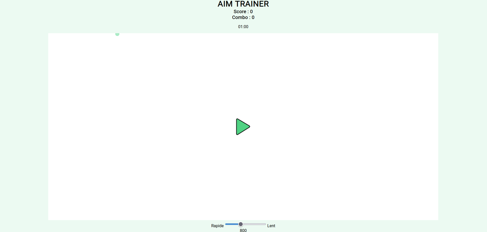
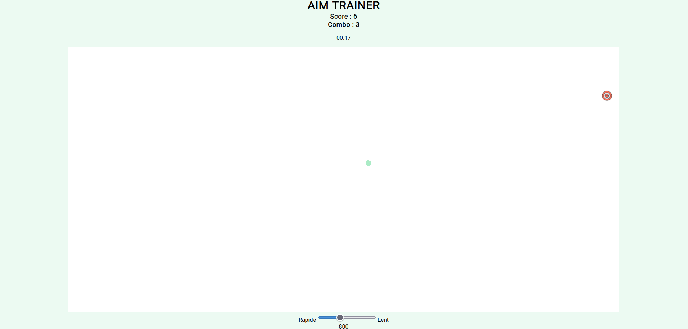

**Description:**
This project serves as a focused technical exercise designed to achieve hands-on proficiency with the **PixiJS** rendering engine. Rather than aiming to build a competitive commercial game, the goal was to rapidly apply PixiJS principles within a 2D Canvas environment.

Using a standard HTML/CSS/JavaScript stack, I created a playable Aim Trainer where targets appear randomly on the screen, requiring the user to click on them within a specified timeframe.

**Skills Demonstrated:**
*   **PixiJS Mastery:** Successfully applied PixiJS core concepts, including scene management, rendering objects (sprites), movement, and collision detection.
*   **2D Canvas Programming:** Proficiently managed object rendering and updates within the Canvas context.
*   **Foundational Web Stack:** Seamless integration of the application into a complete HTML/CSS/JS file structure.

    

    

