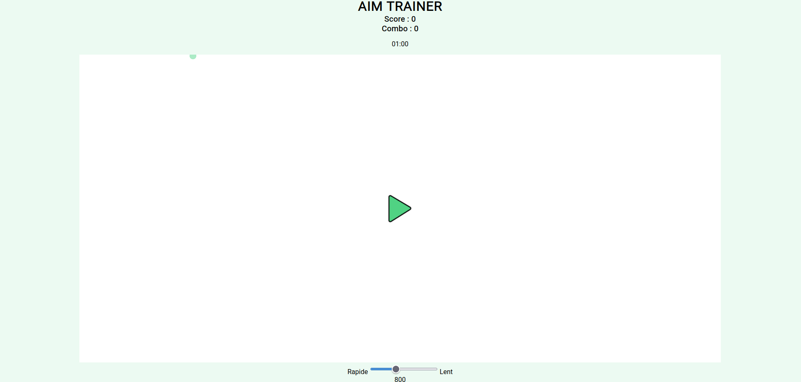
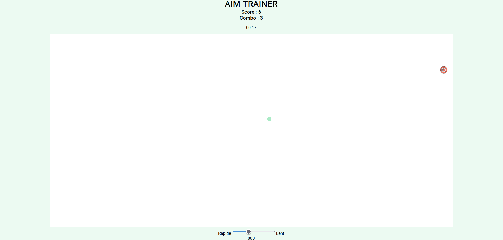

**Description :**
Ce projet est un exercice ciblé visant à maîtriser les bases de la bibliothèque graphique **PixiJS** pour le développement rapide en environnement Canvas 2D. L'objectif principal n'était pas de créer un produit fini, mais plutôt d'appliquer les concepts clés de PixiJS.

En utilisant une structure simple (HTML, CSS, JavaScript), j'ai réussi à mettre en œuvre unAim Trainer où l'utilisateur doit viser et cliquer sur des cibles apparaissant aléatoirement sur un canvas.

**Compétences démontrées :**
*   **Maîtrise de PixiJS :** J'ai appris à gérer les rendus, les sprites, les mises à jour de scène et la détection des collisions au sein de l'environnement Pixi.
*   **Développement Canvas 2D :** Création d'une application graphique fluide en utilisant le contexte Canvas.
*   **Fondations Web :** Intégration complète dans une structure HTML/CSS/JS.

    

    

