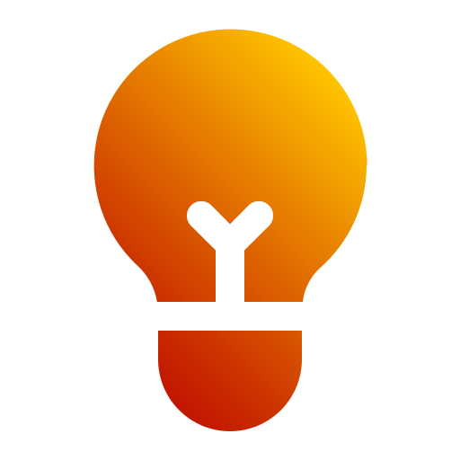

# Brightness Control App

**Application desktop légère pour piloter la luminosité des écrans sous Ubuntu.**

Projet personnel - conception, développement et documentation.

### Contexte et objectif

Sous Ubuntu, gérer la luminosité de plusieurs écrans n’est pas toujours simple, notamment lorsque l’on utilise des configurations multi-écrans. **Brightness Control App** répond à ce besoin avec une application desktop simple : régler la luminosité d’un écran individuellement ou de tous les écrans simultanément, via la commande système `xrandr`.

L’objectif était de proposer une alternative légère, rapide et intuitive, sans surcouche lourde, tout en gardant une architecture moderne et maintenable.

### Fonctionnalités clés

- **Réglage individuel** : ajuster la luminosité de chaque écran indépendamment.
- **Réglage global** : modifier tous les écrans en une seule action.
- **Interface simple et intuitive** : sélection de l’écran, slider de luminosité et bouton d’application.
- **Application légère et performante** : interface ReactTS, backend Rust via Tauri.
- **Packaging desktop** : distribution au format `.deb` pour Ubuntu.

### Stack technique

- **Frontend** : ReactTS
- **Backend** : Rust
- **Framework desktop** : TauriJS
- **Système** : `xrandr` pour le contrôle de la luminosité sous Ubuntu
- **Packaging** : `.deb`

### Défis techniques et points d’apprentissage

- Intégration d’appels système `xrandr` depuis une application Tauri.
- Gestion d’une configuration multi-écrans avec réglages individuels et globaux.
- Communication frontend ReactTS / backend Rust.
- Création d’une expérience utilisateur simple pour une action système technique.
- Packaging et distribution d’une application desktop Ubuntu.

### Roadmap produit

- **Paramètres de thème** : personnalisation de l’apparence de l’application.
- **Configuration au démarrage** : sauvegarde et application automatique des réglages de luminosité au lancement.
- **Améliorations UX** : feedback visuel, gestion des erreurs et détection automatique des écrans.

### Ce que ce projet démontre

- **Côté développeur** : maîtrise d’une stack desktop moderne ReactTS / Rust / Tauri, intégration système et packaging.
- **Côté chef de projet** : cadrage d’un besoin utilisateur concret, priorisation d’un MVP et documentation du projet.
- **Côté Product Owner** : approche centrée utilisateur, définition d’une roadmap et amélioration continue de l’expérience.

**Licence** : MIT

    

