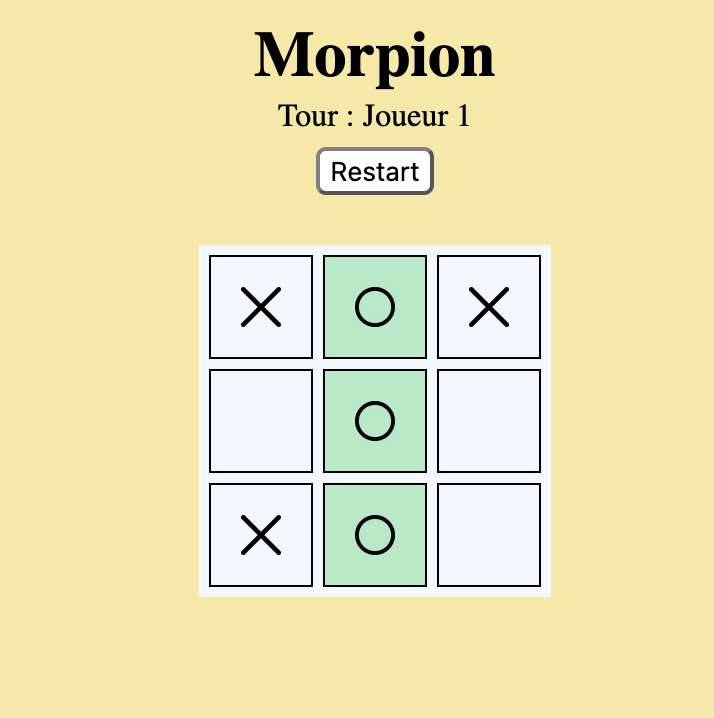

**Description:**
This project is a complete, functional Tic-Tac-Toe board built to demonstrate proficiency in client-side programming. It showcases my ability to architect a small yet robust interactive application.

The core logic is entirely managed by **JavaScript**, handling all aspects of gameplay:
* Turn sequencing (X vs O management).
* Event handling via user clicks (`caseClick`).
* Real-time win/draw condition checking against predefined win combinations.
* Dynamic rendering of moves onto the visual grid using images (`x.png`, `o.png`).
* **CSS** is used to provide a clean and visually appealing presentation.

**Skills Showcased:** Core Programming Logic, JavaScript DOM Manipulation, Event-Driven Programming, HTML/CSS Styling.

    

