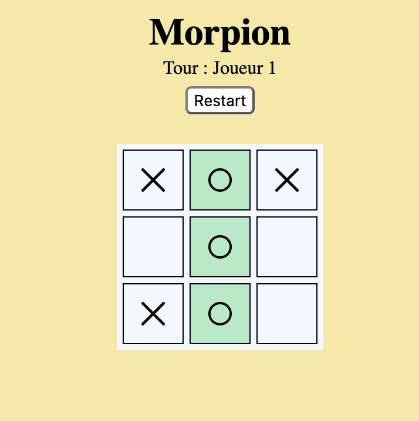

**Description :**
Ce projet est une implémentation complète d'un jeu de Morpion (Tic-Tac-Toe). Il démontre ma capacité à structurer une logique applicative complète dans un langage côté client.

J'ai développé l'intégralité du jeu en utilisant **JavaScript** pour gérer :
* Le déroulement du jeu (alternance des tours X/O).
* La gestion des clics utilisateurs (`caseClick`).
* La vérification en temps réel des conditions de victoire ou de match nul.
* La mise à jour dynamique de l'interface pour afficher les symboles (grâce aux images `x.png` et `o.png`).
* Les styles visuels sont gérés par **CSS** pour une expérience utilisateur agréable.

**Compétences mises en avant :** Logique de programmation, JavaScript DOM Manipulation, Programmation événementielle, HTML/CSS.

    

