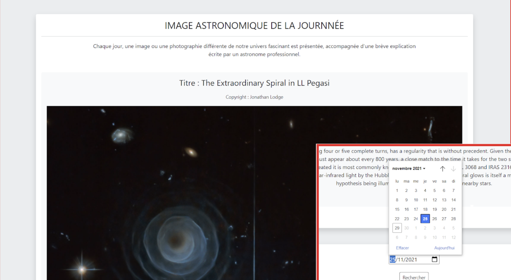

**Description:**
This is a dynamic web application serving as a daily visualizer for astronomical phenomena, pulling real-time data from the official NASA Astronomy Picture of the Day (APOD) API.

My goal was to consume the raw data provided by the API (title, description, image URL, media type) and present it within a polished, professional user interface built using **Bootstrap**.

**Key Features Implemented:**
*   **Dynamic Display:** Displays the day's astronomical image and detailed information.
*   **API Integration (Data Fetching):** Successfully queried and parsed data from the NASA API endpoint.
*   **Historical Search Functionality:** Implemented a date picker form allowing users to search for and view the APOD from any past date.
*   **Technologies Used:** PHP (Server-side processing, API fetching), JavaScript (Date manipulation/validation), HTML/CSS (Structure and styling via Bootstrap).

    

