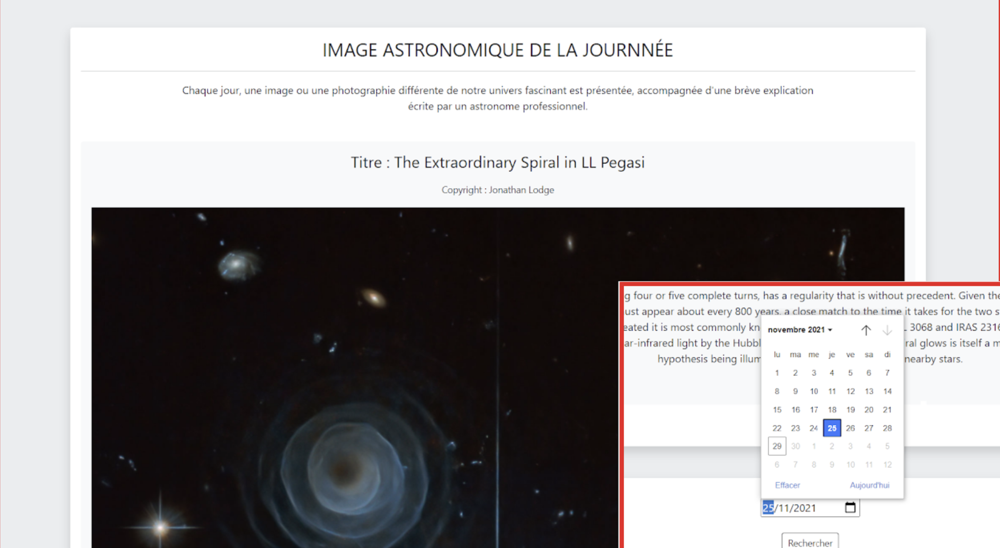

**Description :**
Ce projet est une application web dynamique qui sert de visualiseur quotidien des phénomènes astronomiques grâce à l'API publique de la NASA (Astronomy Picture of the Day - APOD).

Mon objectif était de prendre les données brutes fournies par l'API (titre, description, URL de l'image, type de média) et de les présenter dans une interface utilisateur agréable et professionnelle, rendue grâce à **Bootstrap**.

**Fonctionnalités clés développées :**
*   **Affichage Dynamique :** Affichage de l'image et des détails astronomiques du jour (ou d'une date spécifique).
*   **Intégration API (Fetch Data) :** Récupération asynchrone des données auprès de l'API NASA.
*   **Navigation Temporelle :** Implémentation d'un formulaire de recherche permettant à l'utilisateur de sélectionner une date passée pour afficher l'APOD de ce jour-là.
*   **Technologies :** PHP (pour le serveur côté serveur et la gestion de l'API), JavaScript (pour la sélection de la date), HTML/CSS (pour la structure et le style avec Bootstrap).

    

