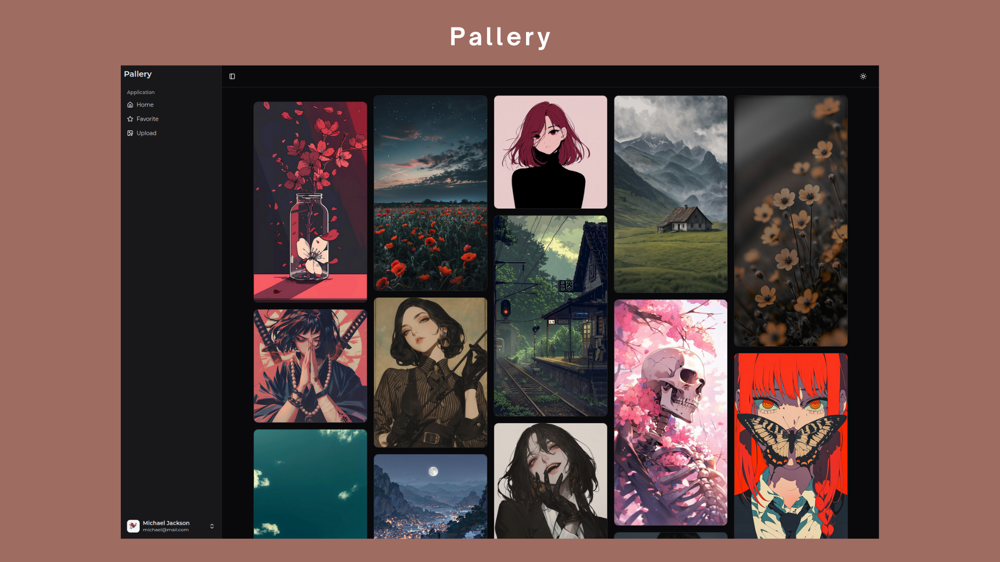

    

# Pallery - Hébergement d’images personnel style Pinterest

    

**Description**
Pallery est une application web de type Pinterest qui permet à chaque utilisateur de gérer sa propre galerie d’images. Après inscription et connexion, l’utilisateur peut uploader des images, les marquer comme favorites et les consulter dans une grille responsive. Le projet est séparé en un frontend React TypeScript et un backend Express.js/Node.js, avec Supabase pour la base de données.

**Fonctionnalités clés**
- Inscription et connexion utilisateur.
- Routes protégées pour les utilisateurs authentifiés.
- Upload d’images dans une galerie personnelle.
- Ajout d’images aux favoris.
- Affichage des images dans une grille responsive de style Pinterest.
- API REST pour l’authentification et la gestion des images.
- Configuration par variables d’environnement.
- Documentation de setup frontend, backend et base de données.

**Stack technique**
- Frontend : React TypeScript, Vite, shadcn/ui
- Backend : Express.js, Node.js
- Base de données : Supabase, avec dump SQL fourni
- Authentification : JWT côté backend
- Communication : API REST

**Ce que le projet démontre**
- Conception d’une application web complète avec frontend, backend et base de données.
- Mise en place d’une authentification et de routes protégées.
- Gestion d’uploads d’images et d’une galerie personnelle.
- Séparation claire des responsabilités entre interface, API et stockage des données.
- Documentation technique structurée pour installer et lancer le projet.
