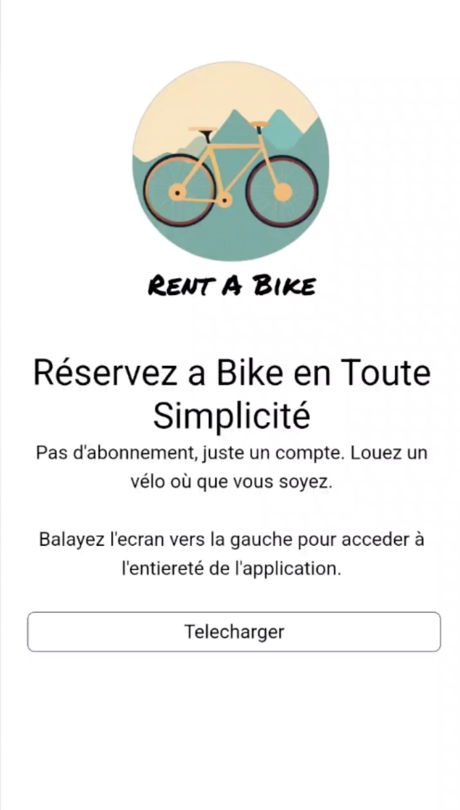
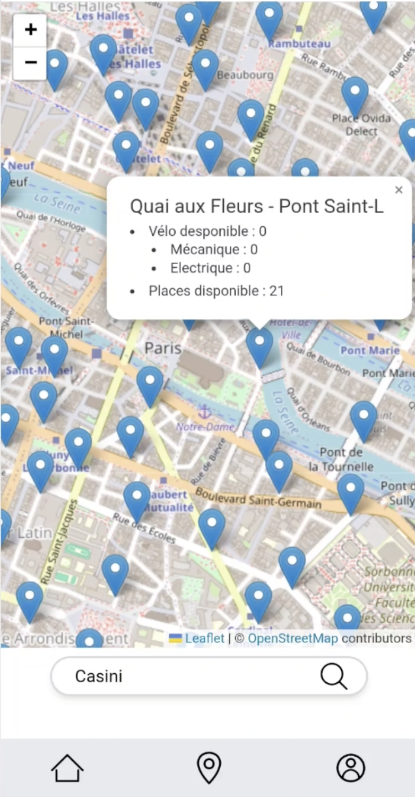
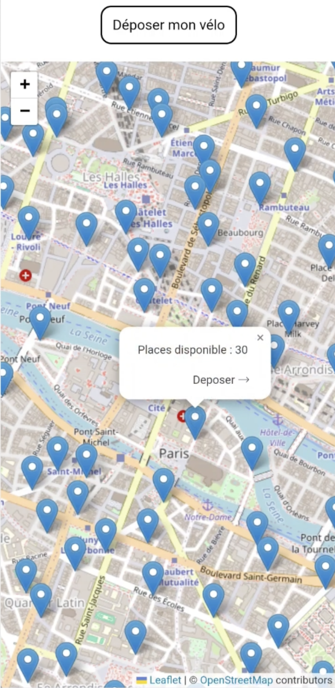

### RentABike: Academic Project on Bike-Sharing Platform

**RentABike is the culmination of an ambitious academic project** aimed at designing a complete digital solution for urban bike management, modeled after the proven Vélib system. This project demonstrates our ability to apply advanced software development concepts within a realistic, simulated operational framework.

**Data Source:**
To ensure the realism and validity of our simulation, the geographical and operational data powering our search engine are based on the **actual stations belonging to Vélib Île-de-France**, accessed via their official API.

**Project Goal:**
To deliver a holistic digital solution, evolving from a basic functional proof-of-concept into a scalable, robust service.

**Key Features Implemented:**
* **Real-Time Visualization (V1):** An interactive map using genuine Vélib station data to display precise bike availability and location in real-time.
* **Reservation System (V2):** Implementation of a secure reservation engine to simulate a complete user transaction flow.
* **Advanced Mobile Experience (V3):** Development of a mobile application featuring QR code scanning for seamless bike unlocking and docking.
* **Complete Management (V4):** Implementation of multi-role user management (Client, Admin, Technician) to simulate a fully operational backend ecosystem.

**Technologies Used:**
The project employs a modern, enterprise-grade architecture:
* **Backend:** Built with Node.js and NestJS, handling business logic, secure authentication, and providing a robust RESTful API.
* **Database:** MySQL ensures transactional reliability for all tracked data.
* **Frontend:** Developed with React and TypeScript, ensuring a highly responsive UI and seamless integration with the live data stream from the Vélib API.

**Technical Challenges Overcome:**
We successfully addressed critical issues such as managing **concurrency** during simultaneous reservations, implementing stringent security protocols (including bcrypt hashing), and optimizing SQL queries to handle the dynamic data flow sourced from the live Vélib API.

<table>
    <tr>
        <td align="center" valign="top">
            
             <b>Home</b>
        </td>
        <td width="20"></td>
        <td align="center" valign="top">
            
             <b>Station selection</b>
        </td>
        <td width="20"></td>
        <td align="center" valign="top">
            
             <b>Drop off the bike</b>
        </td>
    </tr>
</table>