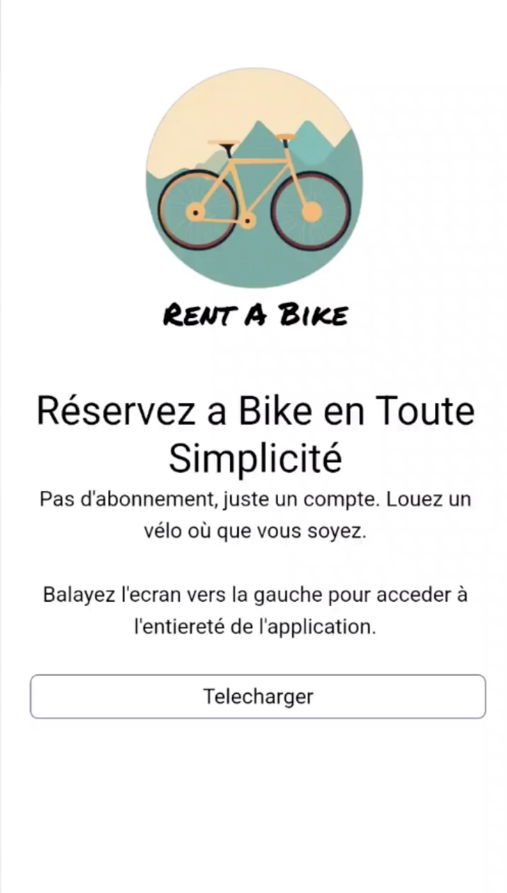
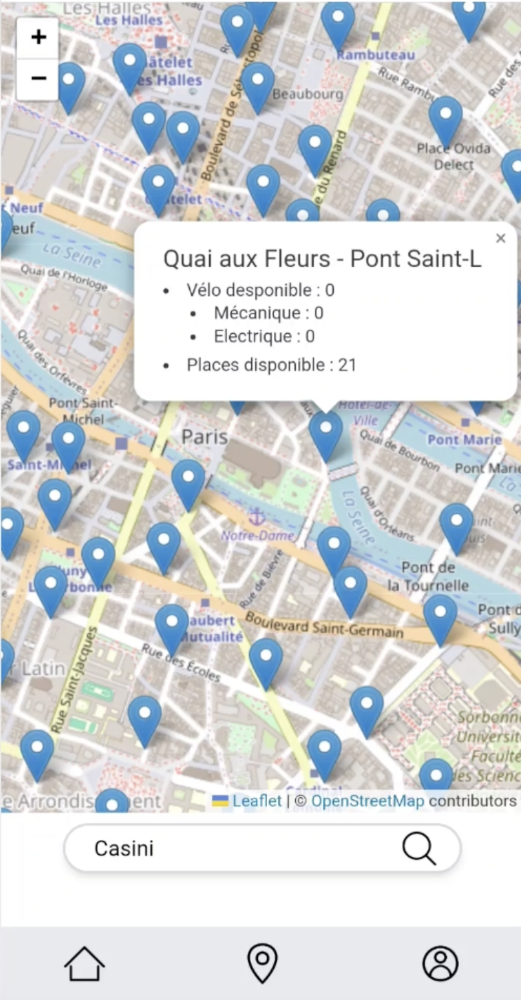
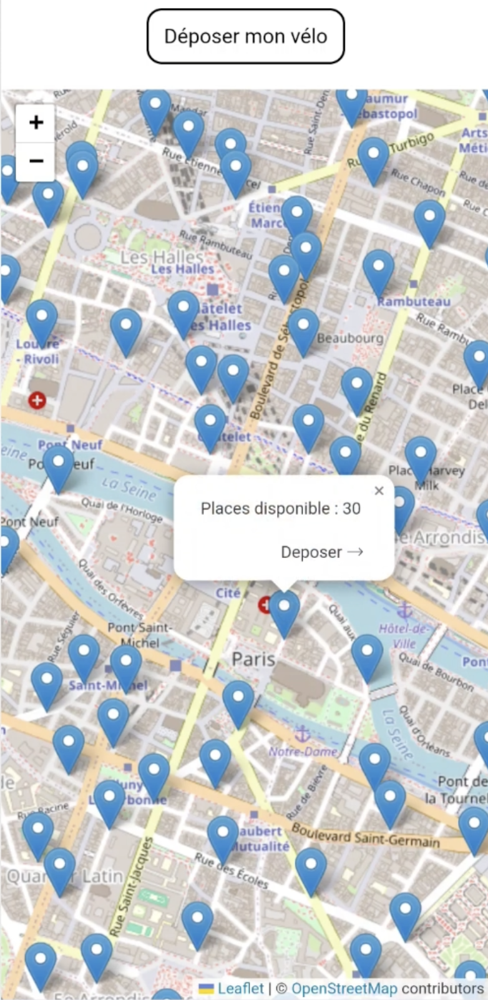

### RentABike : Projet Académique de Plateforme de Location de Vélos en Libre-Service

**RentABike est le fruit d'un projet scolaire ambitieux** qui vise à concevoir une solution numérique complète pour la gestion de vélos urbains, inspirée et basée sur le modèle éprouvé de Vélib. Ce projet démontre notre capacité à appliquer des concepts avancés de développement logiciel dans un cadre réel.

**Données Utilisées :**
Pour garantir la pertinence de notre simulation, les données géographiques et opérationnelles utilisées pour notre moteur de recherche sont basées sur les **données réelles des stations Vélib de l'Île-de-France**, lesquelles ont été accessibles via leur API officielle.

**Objectif du Projet :**
Fournir une solution numérique complète pour la gestion de vélos urbains, passant d'une simulation initiale à un service riche et évolutif.

**Fonctionnalités Clés Développées :**
* **Visualisation en Temps Réel (V1) :** Une carte interactive utilisant les données réelles des stations Vélib pour afficher l'emplacement et la disponibilité précise des vélos.
* **Système de Réservation (V2) :** Mise en place d'un moteur de réservation sécurisé pour simuler une expérience utilisateur complète.
* **Expérience Mobile Avancée (V3) :** Développement d'une application mobile avec reconnaissance QR Code pour une activation et un dépôt fluides.
* **Gestion Complète (V4) :** Mise en œuvre de rôles utilisateurs multiples (Client, Admin, Réparateur) pour simuler un système de gestion opérationnel.

**Technologies Utilisées :**
Le projet repose sur une architecture moderne :
* **Backend :** Développé avec Node.js et NestJS, il gère la logique métier, l'authentification et expose une API RESTful robuste.
* **Base de Données :** MySQL assure la fiabilité transactionnelle des données.
* **Frontend :** Construit avec React et TypeScript, assurant une interface utilisateur réactive et une parfaite intégration avec les données sources.

**Défis Techniques Relevés :**
Nous avons réussi à implémenter des solutions pour les défis de gestion des **concurrences** lors des réservations simultanées, avons sécurisé le système avec une authentification robuste (bcrypt), et optimisé les requêtes pour gérer efficacement le flux de données simulées issues de l'API Vélib.

<table>
    <tr>
        <td align="center" valign="top">
            
             <b>Accueil</b>
        </td>
        <td width="20"></td>
        <td align="center" valign="top">
            
             <b>Choix de station</b>
        </td>
        <td width="20"></td>
        <td align="center" valign="top">
            
             <b>Déposer le vélo</b>
        </td>
    </tr>
</table>