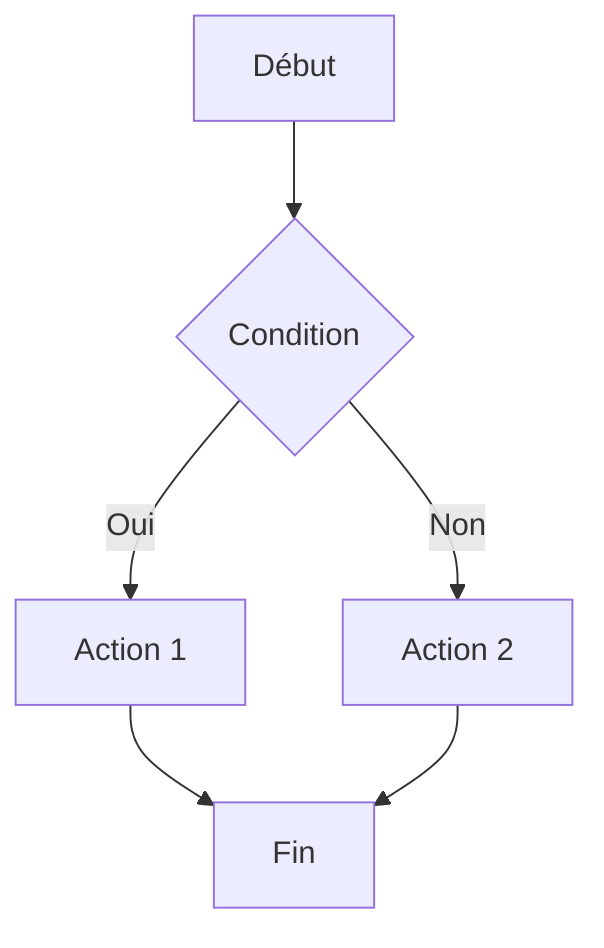
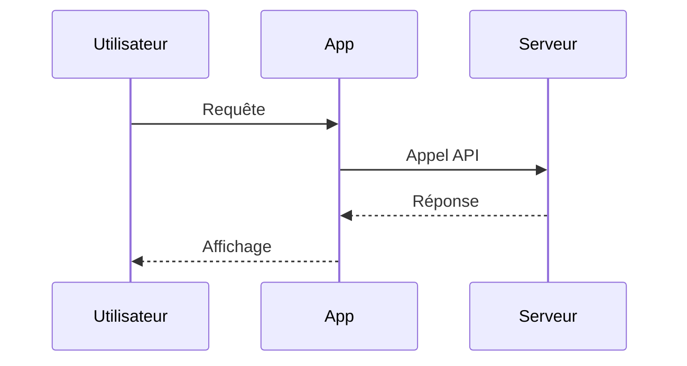

# 🧪 Fichier de Test Markdown Complet

Voici un fichier markdown exhaustif pour tester tous les éléments de rendu de ton application. Copie-le dans un fichier `.md` et ouvre-le dans ton app.

---

## 📝 Titres (Headings)

# H1 - Titre de niveau 1
## H2 - Titre de niveau 2
### H3 - Titre de niveau 3
#### H4 - Titre de niveau 4
##### H5 - Titre de niveau 5
###### H6 - Titre de niveau 6

### Titre alternatif H1
===

### Titre alternatif H2
---

## ✍️ Styles de texte

**Texte en gras**  
*Texte en italique*  
***Texte gras et italique***  
~~Texte barré~~  
`Texte en code inline`  
**Gras avec *italique* imbriqué**  
Texte normal avec un mot **important** au milieu.

<u>Texte souligné (HTML)</u>  
<mark>Texte surligné (HTML)</mark>  
H<sub>2</sub>O (indice)  
E = mc<sup>2</sup> (exposant)

## 📋 Listes

### Liste non ordonnée
- Élément 1
- Élément 2
  - Sous-élément 2.1
  - Sous-élément 2.2
    - Sous-sous-élément 2.2.1
- Élément 3

### Liste ordonnée
1. Premier
2. Deuxième
3. Troisième
   1. Sous-étape 3.1
   2. Sous-étape 3.2

### Liste de tâches
- [x] Tâche terminée
- [ ] Tâche à faire
- [ ] Autre tâche
  - [x] Sous-tâche faite
  - [ ] Sous-tâche restante

### Liste mixte
1. Étape numérotée
   - Point à puce
   - Autre point
2. Deuxième étape
   - [ ] Case à cocher
   - [x] Case cochée

## 🔗 Liens et images

[Lien simple](https://example.com)  
[Lien avec titre](https://example.com "Titre du lien")  
<https://example.com> (lien automatique)  
<email@example.com>

[Lien de référence][ref1]

[ref1]: https://example.com "Lien via référence"

  


## 💬 Citations (Blockquotes)

> Citation simple sur une ligne.

> Citation sur plusieurs lignes
> qui continuent ici.

> Citation avec **formatage** et `code`.
>
> > Citation imbriquée
>
> Retour au niveau principal.

## 💻 Blocs de code

### Code inline
Utilise `npm install` pour installer les dépendances.

### Bloc sans langage
```
Texte brut dans un bloc
Ligne 2
Ligne 3
```

### JavaScript
```javascript
function salutation(nom) {
  console.log(`Bonjour ${nom} !`);
  return true;
}
salutation("Monde");
```

### Python
```python
def fibonacci(n):
    if n <= 1:
        return n
    return fibonacci(n-1) + fibonacci(n-2)

print([fibonacci(i) for i in range(10)])
```

### HTML
```html
<!DOCTYPE html>
<html>
  <head><title>Test</title></head>
  <body><h1>Hello</h1></body>
</html>
```

### CSS
```css
.container {
  display: flex;
  justify-content: center;
  color: #333;
}
```

### Diff
```diff
- ligne supprimée
+ ligne ajoutée
  ligne inchangée
```

## 📊 Tableaux

### Tableau simple
| Colonne 1 | Colonne 2 | Colonne 3 |
|-----------|-----------|-----------|
| A         | B         | C         |
| D         | E         | F         |

### Tableau avec alignement
| Gauche | Centre | Droite |
|:-------|:------:|-------:|
| a      | b      | c      |
| long texte | centré | 123 |
| 1      | 2      | 3      |

### Tableau avec formatage
| Nom     | Statut        | Priorité |
|---------|---------------|----------|
| Tâche A | ✅ **OK**     | 🔴 Haute |
| Tâche B | ⏳ *En cours* | 🟡 Moyenne |
| Tâche C | ❌ `Échec`    | 🟢 Basse |

## ➖ Séparateurs

Contenu au-dessus.

---

Contenu en dessous.

***

Autre type de séparateur.

___

Troisième type.

## ⌨️ Raccourcis et caractères spéciaux

- Flèches : → ← ↑ ↓ ⇒ ⇐
- Puces : • ◦ ▪ ▫
- Symboles : © ® ™ € £ ¥ § ¶ † ‡
- Mathématiques : ≠ ≤ ≥ ± × ÷ ∞ ∑ ∏ √ ∫
- Emojis : 😀 🎉 🚀 ✅ ❌ ⚠️ 🔥 💡 📌

## 🧩 HTML embarqué

<div style="border: 2px solid #4CAF50; padding: 10px; border-radius: 8px; background: #f0fff0;">
  <strong>Bloc HTML personnalisé</strong><br>
  Ce contenu est écrit en HTML dans le markdown.
</div>

<br>

<details>
  <summary>Cliquer pour afficher plus</summary>
  Contenu caché qui se révèle au clic !
</details>

## 📐 Formules mathématiques (si supporté)

Inline : $E = mc^2$

Bloc :

$$
\int_{a}^{b} f(x)\,dx = F(b) - F(a)
$$

$$
\sum_{i=1}^{n} i = \frac{n(n+1)}{2}
$$

## 📌 Notes de bas de page

Voici une affirmation[^1] et une autre source[^2].

[^1]: Première note de bas de page.
[^2]: Deuxième note avec un [lien](https://example.com).

## 🎨 Diagrammes Mermaid (si supporté)





## 🎯 Cas limites et tests de robustesse

### Texte très long
Lorem ipsum dolor sit amet, consectetur adipiscing elit. Sed do eiusmod tempor incididunt ut labore et dolore magna aliqua. Ut enim ad minim veniam, quis nostrud exercitation ullamco laboris nisi ut aliquip ex ea commodo consequat. Duis aute irure dolor in reprehenderit in voluptate velit esse cillum dolore eu fugiat nulla pariatur.

### Ligne très longue sans retour
CeciEstUnTestPourVérifierQueLesMotsTrèsLongSansEspacesNeCassentPasLaMiseEnPageOuNeDébordentPasDeLeurConteneurEtRestentLisiblesMêmeSurDesÉcransÉtroitsCeQuiEstUnBonTestDeResponsiveDesign

### URL longue
https://example.com/chemin/tres/long/avec/beaucoup/de/segments/et/des/parametres?query=test&value=123&autre=xyz

### Caractères d'échappement
\*Pas italique\* \`Pas code\` \# Pas titre \[Pas lien\]

### Balises non fermées
Voici du **gras non fermé et du *texte bizarre

### Code avec backticks
`` Code avec `backtick` à l'intérieur ``
