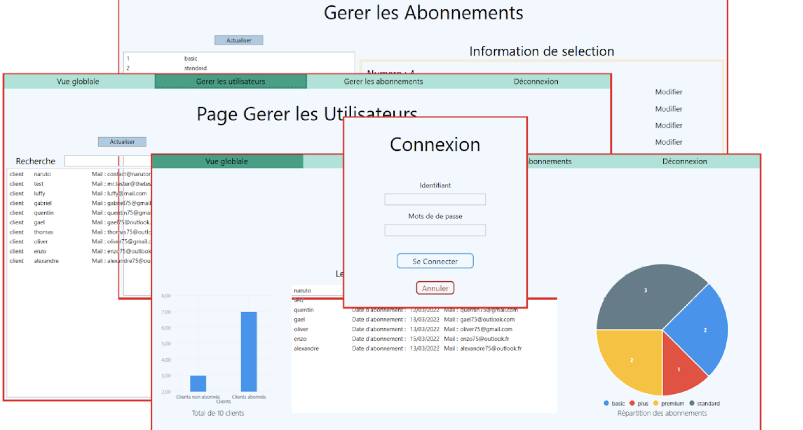

**Project Title:** Facturation Management System - C# Desktop Application

**Description:**
A robust desktop application developed in C#/.NET. This project showcases my ability to build complex business logic layers by connecting to a SQL database. Key features include user authentication, comprehensive user management, and a powerful administrative dashboard presenting billing statistics through Pie and Bar charts.

My responsibilities focused on building a secure and functional management tool, including:
*   **Security Implementation:** Developing a secure authentication system to restrict access to sensitive financial data.
*   **User Administration:** Creating a dedicated module to manage user accounts and permissions within the application.
*   **Analytical Dashboard:** Designing a comprehensive global view featuring dynamic visualizations (Pie Charts and Bar Charts) to provide powerful, at-a-glance business statistics on billing activity.

**Technologies Used:** C#, .NET, SQL.

    

