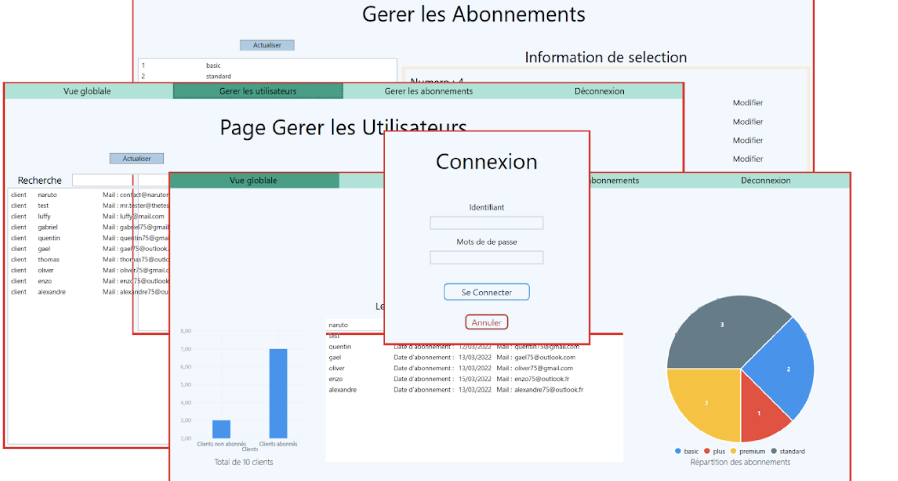

**Titre du Projet :** Back-Office de Gestion Facturation (Application de Bureau)

**Description :**
Application de bureau développée en C# (.NET) servant de back-office pour un système de facturation. Ce projet académique prouve ma maîtrise de la couche applicative en dehors du contexte purement web. Les fonctionnalités incluent l'authentification utilisateur, la gestion complète des utilisateurs du système, et un tableau de bord graphique puissant affichant les statistiques de facturation via diagrammes circulaires et à barres.

Mon rôle a été de construire la logique métier complète du système, incluant :
*   **Gestion Sécurisée :** Mise en place d'un système d'authentification robuste pour garantir l'accès aux données.
*   **Administration Utilisateurs :** Développement d'un module permettant de gérer les comptes et les droits des utilisateurs au sein du système.
*   **Tableau de Bord Analytique :** Conception d'une vue globale intégrant des représentations graphiques (Pie Chart et Bar Chart) pour visualiser les statistiques clés de l'activité facturation.

**Technologies utilisées :** C#, .NET, SQL Server.

    

