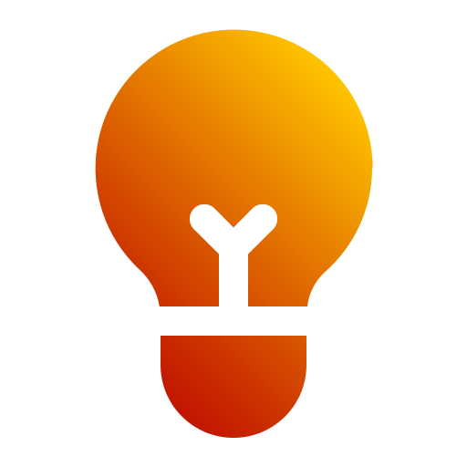

# Brightness Control App

**A lightweight desktop app to control screen brightness on Ubuntu.**

Personal project — design, development and documentation.

### Context and goal

On Ubuntu, managing brightness across multiple screens is not always straightforward, especially in multi-monitor setups. **Brightness Control App** addresses this need with a simple desktop application: adjust the brightness of an individual screen or all screens at once using the system `xrandr` command.

The goal was to provide a lightweight, fast and intuitive alternative without unnecessary overhead, while keeping a modern and maintainable architecture.

### Key features

- **Individual screen control**: adjust each screen’s brightness independently.
- **Global screen control**: change all screens at once.
- **Simple and intuitive UI**: screen selection, brightness slider and apply button.
- **Lightweight and efficient**: ReactTS frontend, Rust backend through Tauri.
- **Desktop packaging**: distributed as a `.deb` package for Ubuntu.

### Tech stack

- **Frontend**: ReactTS
- **Backend**: Rust
- **Desktop framework**: TauriJS
- **System**: `xrandr` for brightness control on Ubuntu
- **Packaging**: `.deb`

### Technical challenges and learning outcomes

- Integrating `xrandr` system calls into a Tauri application.
- Handling multi-monitor configurations with individual and global brightness settings.
- Enabling communication between the ReactTS frontend and Rust backend.
- Designing a simple user experience for a technical system action.
- Packaging and distributing an Ubuntu desktop application.

### Product roadmap

- **Theme settings**: customize the app’s look and feel.
- **Startup configuration**: save and automatically apply brightness settings at launch.
- **UX improvements**: visual feedback, error handling and automatic screen detection.

### What this project demonstrates

- **As a developer**: experience with a modern desktop stack — ReactTS / Rust / Tauri — system integration and packaging.
- **As a project manager**: scoping a concrete user need, prioritizing an MVP and documenting the project.
- **As a product owner**: user-centered thinking, roadmap definition and continuous UX improvement.

**License**: MIT

    

