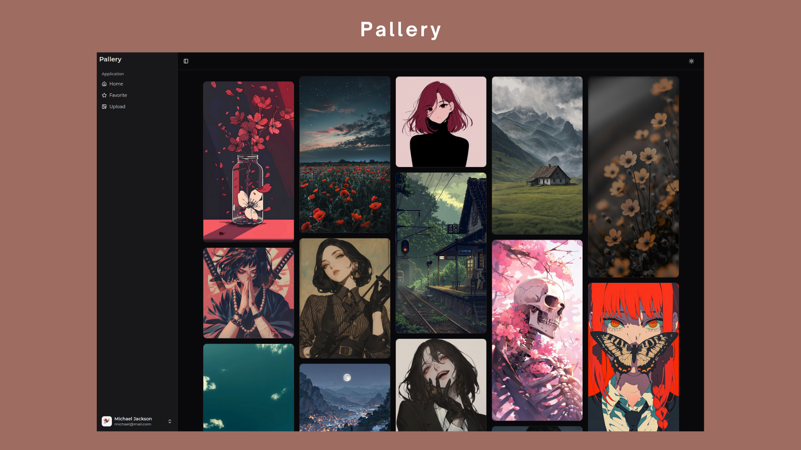

    

# Pallery — Personal Pinterest-Style Image Hosting

    

**Overview**  
Pallery is a Pinterest-style web application that lets each user manage a personal image gallery. After signing up and logging in, users can upload images, mark them as favorites, and browse them in a responsive grid layout. The project is split into a React TypeScript frontend and an Express.js/Node.js backend, with Supabase as the database.

**Key features**
- User registration and login.
- Protected routes for authenticated users.
- Image upload to a personal gallery.
- Favorite image management.
- Pinterest-style responsive image grid.
- REST API for authentication and image management.
- Environment-based configuration.
- Setup documentation for frontend, backend, and database.

**Technical stack**
- Frontend: React TypeScript, Vite, shadcn/ui
- Backend: Express.js, Node.js
- Database: Supabase, with provided SQL dump
- Authentication: JWT on the backend
- Communication: REST API

**What this project demonstrates**
- Building a full web application with frontend, backend, and database.
- Implementing authentication and protected routes.
- Handling image uploads and a personal gallery.
- Clear separation between UI, API, and data storage.
- Structured technical documentation for setup and running the project.

