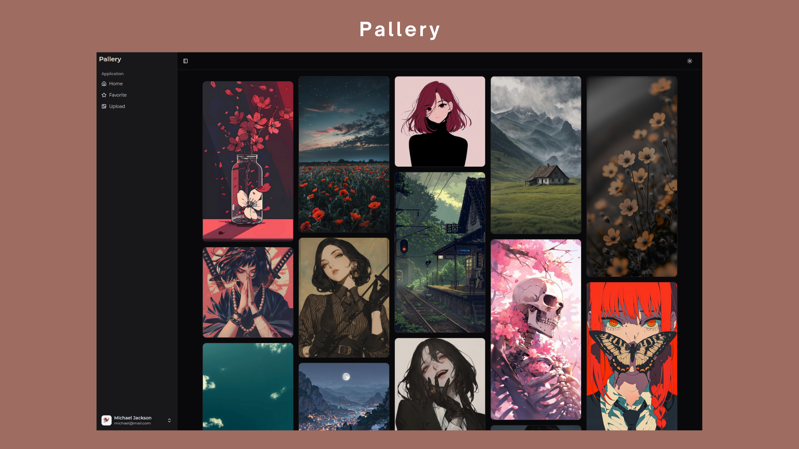

    

# **Pallery**

**Your Personal Image Hosting!**

    

## Version française

# Pallery : Galerie d’images personnelle inspirée de Pinterest

**Pallery** est une application web full-stack inspirée de Pinterest, permettant aux utilisateurs de créer et gérer leur galerie d’images personnelle. Les utilisateurs peuvent téléverser des images, les retrouver dans une grille responsive et les ajouter à leurs favoris. L’accès à la galerie est protégé par une authentification.

### Fonctionnalités principales

- Téléversement d’images dans une galerie personnelle
- Ajout d’images aux favoris
- Affichage des images dans une mise en page responsive en grille
- Accès sécurisé à la galerie après connexion
- Interface inspirée de Pinterest

### Stack technique

- **Frontend :** TypeScript, configuration centralisée, consommation d’API
- **Backend :** Node.js, API serveur, gestion des variables d’environnement
- **Base de données :** Supabase, avec schéma SQL versionné
- **Authentification :** JWT
- **Architecture :** séparation claire entre frontend, backend, base de données et documentation

### Points techniques

- Gestion des secrets et de la configuration via variables d’environnement
- Authentification basée sur JWT
- Export SQL de la base de données pour faciliter l’installation et la reproduction du projet
- Structure de projet organisée : `/app`, `/server`, `/database`, `/docs`
- Documentation dédiée pour le frontend, le backend et la base de données

### Liens

- Démo : [à ajouter]
- Code source : [à ajouter]
- Documentation : [à ajouter]

### Licence

Projet sous licence MIT.
